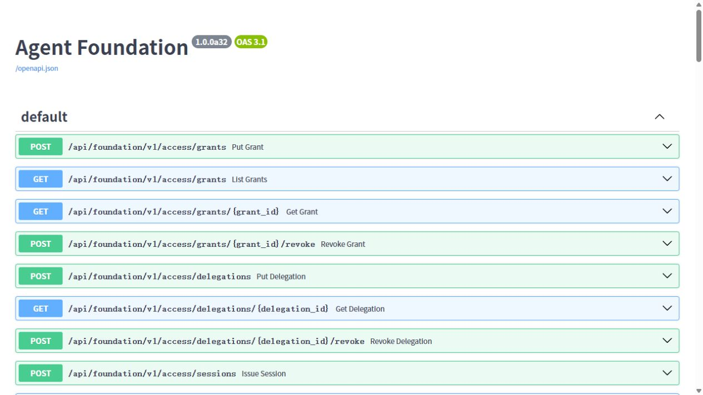
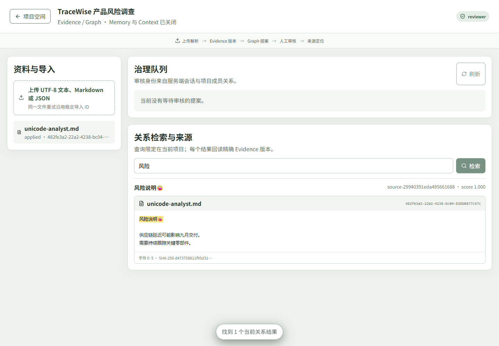
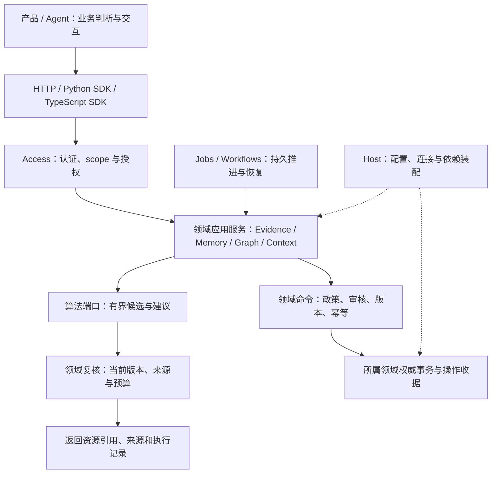

# Agent Foundation

**面向 Agent 应用的记忆、证据、关系图与上下文基础服务。**

Agent 可以提出候选和建议；是否能写入、何时生效、依据是否仍有效，由各领域服务判断。Foundation 将这条边界落实到独立授权、领域命令、版本检查、审核、幂等收据和持久任务中。

项目采用 **Python 模块化单服务 + 独立 Python / TypeScript SDK**。TraceWise 作为资料分析采用方，验证 Evidence 与 Graph 的组合；教学场景使用 Memory 和可选 Context。产品保留业务判断，Foundation 提供可复用的状态与执行边界。

[快速运行](#快速运行) · [核心能力](#核心能力) · [架构设计](#架构设计) · [源码导览](#源码导览) · [在线图谱](https://mumuyang068.github.io/Agent-Foundation/) · [演示说明](docs/portfolio/DEMO.md)

## 运行与采用

### Foundation 公共 API



服务提供 `/api/foundation/v1` 下的领域接口与 OpenAPI 文档。最小示例只启用 Access、Evidence、Graph，控制记录与图写入使用独立 SQLite 文件。

### 资料如何成为有来源的图结果



TraceWise 架构接入分支的实际页面：上传资料 → Evidence 精确版本 → Graph 提案 → 独立审核 → 结果检索 → 原文定位。截图为 **2026-09-16 隔离运行留存**，使用演示资料，Memory、Context 关闭；不代表当前候选已完成全部产品验收。

### 一条可以自己复现的流程

运行 [graph_roundtrip.py](examples/portfolio/graph_roundtrip.py)，通过安装的 Python SDK 调用真实 HTTP 服务：

```text
分析员接纳 Evidence
  → 提交两个节点和一条关系的 Graph 提案
  → 分析员尝试审核，被权限边界拒绝
  → 独立审核者批准并执行
  → 相同 operation_id 重试，返回原收据
  → 检索 Alpha，得到一个当前节点
  → 撤销来源，Alpha 从普通检索中退出
```

示例使用合成资料 `风险说明😀\nAlpha depends on Beta.`，不需要模型密钥或外部数据库。JSON 收据记录实际执行主体、精确来源、审核结果和撤销前后查询结果。

## 为什么做这个项目

为不同 Agent 产品分别拼接向量库、图数据库和聊天历史，容易混淆几件事：召回到了不等于当前可用，算法建议不等于获准写入，重试成功不等于没有重复副作用，历史快照也不等于当前授权。

Foundation 把这些问题放回各自负责的层：

- **产品决定业务。** 是否值得记忆、怎样解析资料、谁负责审核、后续任务怎样使用结果，由产品决定。
- **领域决定有效性。** Memory、Evidence、Graph、Context 分别拥有状态、版本、生命周期和写入规则。
- **算法提供候选。** 候选、评分、归一化和维护建议是可替换计算，不能取得权威写入口。
- **工作流处理等待与恢复。** 跨域操作通过领域命令推进，保留稳定操作 ID、进度和收据。

## 核心能力

| 模块 | 负责什么 | 典型操作 |
| --- | --- | --- |
| Access | 主体、scope、授权、委托与会话 | 发放 / 撤销 Grant、Session，访问诊断与审计 |
| Evidence | 来源、精确版本、区间和支持关系 | 接纳、限定检索、撤销与重验证 |
| Memory | 长期经验及其演进 | 候选、审核、召回、反馈、纠错与 successor |
| Graph | 节点 / 关系权威、提案和 Schema | 提案、审核、执行、时态读取与批量作业 |
| Context | 一次任务需要的上下文 | 显式引用、来源组合、预算、快照与重放 |
| Jobs | 持久任务的执行生命周期 | 授权、领取、租约、取消与恢复 |
| Management | 宿主侧管理操作 | 配置发布、提取器认证、索引代、评测和恢复入口 |
| Applications | 通过公共合同组合 Agent 回合 | 准备上下文、观察、结果反馈与任务交接 |

这些是当前代码中的职责与入口。逐项旧行为、外部存储恢复及两个产品的完整验收还在收敛。

## 架构设计



### 四份合同分别变化

| 合同 | 回答的问题 |
| --- | --- |
| `AccessGrant` | 谁能在什么 scope 对哪些资源做什么？ |
| `DomainPolicy` | 这个领域怎样审核、保留、失效和演进？ |
| `ExecutionProfile` | 用哪个算法、实现版本、参数和执行预算？ |
| `HostConfiguration` | 启用哪些模块，连接哪些存储与可信实现？ |

更换召回策略不应同时改变用户权限。执行记录引用实际使用的合同版本，领域在返回前核对当前资格。

### Graph 的控制记录与写权威分开

提案、审核和恢复 intent 属于控制库；节点、关系和图写收据属于 Graph 写权威。图变化与写收据在同一个权威事务内提交，随后回填提案状态。控制回填失败时，恢复流程按稳定操作 ID 查收据，避免再次产生图变化。这里没有假定 PostgreSQL 与 Neo4j 之间存在统一事务。

### Context 按需组合

直接使用 Evidence 或 Graph 不必启动 Memory 和 Context。Context 从声明的领域读取端口组合内容，负责引用、预算和快照；独立召回继续由各领域提供。

### 逐层阅读图谱

公开图谱从整体边界进入领域结构、读写机制、身份与恢复，再回到对应源码。JSON 是维护源，生成页面可离线打开。

- [整体职责与采用边界](docs/portfolio/atlas/index.html#overview)
- [Foundation 内部结构](docs/portfolio/atlas/index.html#foundation-structure)
- [Graph 提交与对账](docs/portfolio/atlas/index.html#graph-recovery)
- [Memory 与 Context](docs/portfolio/atlas/index.html#memory-structure)
- [公共合同与源码阅读路线](docs/portfolio/ARCHITECTURE.md)

可直接进入[在线图谱](https://mumuyang068.github.io/Agent-Foundation/)，也可下载仓库后用浏览器打开 `docs/portfolio/atlas/index.html`。GitHub 文件浏览页不会执行交互 HTML；README 中的 Mermaid 可直接阅读。

## 快速运行

需要 Python **3.11–3.13**。默认演示使用 SQLite，无需 Docker、Neo4j、Qdrant 或模型服务。以下为 PowerShell 命令，在仓库根目录执行。

### 1. 安装服务与独立客户端

```powershell
python -m venv .venv
.\.venv\Scripts\python.exe -m pip install . ./sdk/foundation-python
```

这是普通安装，不是 editable 安装。服务包为 `agent-foundation`，客户端包为 `agent-foundation-client`，导入名为 `agent_foundation_client`。真实采用方环境只需安装客户端。

### 2. 创建全新演示数据目录并启动

```powershell
.\.venv\Scripts\python.exe ./examples/portfolio/prepare.py --data ./.demo/run-001
$env:AGENT_FOUNDATION_BOOTSTRAP_TOKEN = [guid]::NewGuid().ToString('N')
.\.venv\Scripts\python.exe -m agent_foundation.host.service_v2 `
  --configuration ./.demo/run-001/host.json --host 127.0.0.1 --port 18765
```

打开 <http://127.0.0.1:18765/docs> 查看 API。`prepare.py` 拒绝复用现有目录；再次演示换一个目录名。bootstrap token 仅供本机初始化，正常业务调用使用逐主体的短期 Session。

### 3. 执行 Evidence → Graph 流程

在第二个 PowerShell 窗口中，将 `AGENT_FOUNDATION_BOOTSTRAP_TOKEN` 设为第一窗口生成的同一值，再运行：

```powershell
.\.venv\Scripts\python.exe ./examples/portfolio/graph_roundtrip.py `
  --base-url http://127.0.0.1:18765 --output ./.demo/run-001/receipt.json
```

脚本发放分析员和审核者各自的 Grant / Session，再使用公共 SDK 完成流程。原始 token 不写入收据。结束后在服务窗口按 `Ctrl+C`，数据库和收据留在 `.demo/`。

### 4. 验证核心流程

```powershell
.\.venv\Scripts\python.exe -m pip install '.[test]'
.\.venv\Scripts\python.exe -m pytest -q `
  backend/tests/test_architecture_pl02_evidence.py `
  backend/tests/test_architecture_pl03_memory.py `
  backend/tests/test_architecture_pl04_graph.py `
  backend/tests/test_architecture_pl05_context.py
```

需要 TypeScript 客户端时，进入 `sdk/typescript` 执行 `npm ci`、`npm test`。它只负责传输与合同，不安装 Python 服务实现。

## 源码导览

```text
backend/agent_foundation/
  kernel/              中立的身份、资源引用、预算与错误
  execution/           算法配置、可信实现与执行记录
  modules/             八个模块的合同、规则、端口和应用操作
  algorithms/          无权威写入权的候选及建议实现
  workflows/           通过领域命令协调持久任务
  adapters/inbound/    HTTP、同进程和可选 MCP
  adapters/outbound/   SQLite / PostgreSQL / Neo4j / Qdrant 等适配
  host/                设施连接、模块装配与运行生命周期
public_contracts/      外部合同与路由目录
sdk/                   Python 与 TypeScript 客户端
examples/portfolio/    可复现的隔离运行示例
docs/portfolio/        架构阅读、运行说明与图谱
```

建议先读 [Graph 应用服务](backend/agent_foundation/modules/graph/application.py)，对照 [Graph 端口](backend/agent_foundation/modules/graph/ports.py)、[Host 装配](backend/agent_foundation/host/minimal.py) 和 [HTTP 薄适配](backend/agent_foundation/adapters/inbound/graph_http.py)，再看测试中的版本竞争、来源失效和恢复场景。

## 当前范围

当前源码为 **a32 独立架构重建线**，Python SDK a4、TypeScript SDK alpha.4。已有领域流程和独立包证据；本次演示覆盖安装态 HTTP、SQLite 分库、独立审核、幂等重放与来源撤销，不把它外推为全部能力完成。

仍在推进的工作包括：375 条旧行为的逐项语义与执行关联、PostgreSQL / Neo4j / Qdrant 实库组合、非 SQLite 完整备份恢复、已应用维护 link 的补偿，以及两个产品在同一候选下的完整页面验收。a33 是后续候选，不作为本 README 的已交付版本。

旧 API 兼容、旧数据迁移和正式产品切换不属于这条重建线的完成前提。
